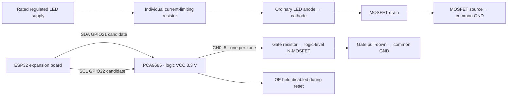

# Provisional lighting hardware and firmware integration

**Not a finished wiring diagram or an upload-ready firmware update.** The uploaded working `.ino`, expansion-board model/pinout, six LEDs' rated voltage/current and fitted resistors, and RGB LED part number/pinout are still missing. Do not infer pins/polarity from wire colors. The repository sketch differs from the described working firmware and remains untouched.

## Known wiring to preserve

| Existing function | ESP32 GPIO |
| --- | --- |
| Rain AO | 34 (input only) |
| Optional rain DO | 27, reserved even if unused |
| DHT22 DATA | 4 |
| Servo signal | 18 |
| Passive buzzer | 19 |

Do not repurpose these pins. Preserve the working firmware's rain policy, stable-dry timing, STOP latch, servo limits, diagnostic fields, Wi-Fi retries, buzzer patterns and all existing endpoint behavior.

## Recommended candidate: external PWM controller

Use a PCA9685-compatible 16-channel I²C PWM controller for the six house outputs, provisionally channels 0–5. Set a suitable LED PWM frequency (candidate 1 kHz, subject to driver/LED validation). It uses an external oscillator and **no ESP32 LEDC channels or timers**, avoiding frequency sharing with the existing 50 Hz servo and variable-frequency passive buzzer. Do not move the existing servo to this board: all PCA9685 channels share its frequency. Inspect the actual working source and exact ESP32 core/servo library before confirming timer ownership; the repository sketch uses automatic ESP32Servo/tone allocation, not a verified explicit channel map.

Candidate I²C pins are GPIO21 SDA and GPIO22 SCL, **only if the expansion-board pinout and working sketch confirm both are free and exposed**. Neither is assigned by the repository sketch. Address 0x40 is a common PCA9685 default, not an assumed address for the user's board; check address jumpers and bus devices. I²C pull-ups must go to 3.3 V with ESP32; do not expose GPIOs to 5 V pull-ups. Verify breakout VCC, V+ and OE markings against its schematic. GPIO6–11 are flash pins, GPIO34–39 cannot output, and boot-strapping pins should be avoided for new loads.

Each house PWM output should control a suitably rated 3.3 V logic-level MOSFET/load driver, with a separate correctly sized current-limiting resistor or constant-current driver per LED. PCA9685 logic outputs are **not** a six-light power supply. For a confirmed simple low-voltage single-color LED, the candidate low-side topology is:



Repeat the load branch six times: CH0 Front, CH1 Left side, CH2 Right side, CH3 Back, CH4 CR, CH5 Balcony. This is a **candidate channel map**, not a statement about existing board terminals. Common ground connects the ESP32, PWM logic, LED supply negative and MOSFET sources; maintain the existing appropriately rated servo/buzzer supplies. Do not route LED/servo load current through ESP32 GPIOs or a small regulator without checking its rating.

Choose each LED's current limit from its datasheet: `R >= (supply_max - LED_Vf_min - driver_drop_min) / target_current`, including tolerance and resistor dissipation with margin. A bare LED needs current limiting; an already resistor-fitted module must be evaluated before adding another resistor. High-power LEDs generally need regulated constant-current drivers and thermal design. Do not select final resistor values, LED rail voltage or MOSFET rating before the voltage/current data arrives. Gate series resistor and pull-down values, supply decoupling and protection also need selection against the actual driver and loads.

Reset safety needs hardware support: hold PCA9685 OE disabled during ESP32/driver startup, and ensure each load-driver input defaults OFF. Provide the appropriate OE pull-up and an enable circuit/GPIO only after checking its logic levels and available board pins. Firmware must set all six channels full-OFF before enabling outputs. Gate pull-downs alone do not disable an actively driven retained PWM output. Firmware OFF after boot does not guarantee OFF during reset/brownout without this circuit. A power cycle/reboot acceptance test must cover both ESP32-only resets and a still-powered PWM board.

For an active-high low-side driver, `!power` or brightness 0 → PCA9685 full-OFF; 100% → full-ON; intermediate percentages → rounded 12-bit duty. Exact register/library full-ON/OFF semantics must be verified against the chosen driver. Store selected percent separately from the emitted duty; OFF must not overwrite brightness.

## RGB indicator remains electrically unassigned

Confirm whether it is a bare common-cathode LED, common-anode LED, an RGB module, or an addressable device, and identify each pin from its datasheet/testing. These need different polarity, current limiting, supplies and drivers. Do not connect it based on this diagram yet. A confirmed analog RGB LED could provisionally use separate external PWM channels 6–8 with three correctly rated driver/current-limit branches; an addressable LED requires a different signal/power interface. No manual house route may address these channels. Do not implement color inversion or a circuit until the actual type is known.

## Required components — conditional bill of materials

- Confirmed compatible PCA9685 I²C PWM board, with 3.3 V logic/pull-ups and known OE behavior.
- Six appropriately rated load-driver channels; three additional channels only if the RGB part requires them. Select guaranteed 3.3 V gate operation, voltage/current and thermal ratings from actual loads.
- Per-LED current limiting (resistors or constant-current drivers as appropriate); gate/reset bias components and supply decoupling/protection.
- Regulated supply rails with headroom for all simultaneous LED loads plus existing rack electronics; retain a suitable separate servo power arrangement and common signal ground.
- Rated wire, connectors and protection appropriate to the measured current. Exact part values and board terminal labels await specifications.

## Integration once the working source is attached

1. Compare and preserve its existing functions and API request/response examples. Record exact ESP32 Arduino core and servo/buzzer library versions. Locate the STOP latch, stable-dry extension, rain scheduler and buzzer timer ownership before edits.
2. Add `HouseLighting.h` beside that working `.ino`. Supply an `Output::write(zone,power,brightness)` adapter for the confirmed external driver. Keep each driver transaction short and bounded; no delay, reconnect loops, NVS writes per slider edit, or changes to motor/buzzer timers. Set a finite I²C timeout and on failure keep rain monitoring/movement running.
3. Create a unique boot session (e.g. hardware RNG-derived token); initialize all house outputs OFF before advertising readiness. Never expose the component's initial fields as actual device state until `ready()` is true. Retained brightness defaults to 50% in RAM and is not persisted.
4. Add GET `/api/lights` and exactly six POST zone routes per [schema 2](LIGHTING_API.md), alongside existing routes. Add a 403 route for `system_status`, OPTIONS as needed, request-body limits and strict JSON/type validation. Do not use substring token extraction to validate these nested HTTP schemas. Serialize the single-threaded component consistently with the firmware's loop/task architecture.
5. GET returns 503 if driver state is uncertain/unready. Return `indicator:null` until a real RGB driver has applied and reported its state. A proposed desired mapping is not confirmed output. Call `indicatorApplied()` only for actual changes, not every loop, and snapshot the state atomically.
6. Compile for ESP32 WROOM-32 with the selected libraries, run host and endpoint tests, then upload to the real rack and execute the acceptance checklist. Produce the complete merged `.ino` and a final diagram labeled with actual expansion-board terminals only after the source and hardware details are available.

The portable component has no GPIO assignment, LEDC allocation, network implementation or RGB output driver. Its host tests validate command/state behavior only. It is scaffolding for a narrow additive merge, not a substitute for the uploaded working firmware.

## Available host checks

```bash
g++ -std=c++17 -Wall -Wextra -Werror firmware/tests/house_lighting_test.cpp -o /tmp/house-lighting-test
/tmp/house-lighting-test
g++ -std=c++17 -Ifirmware/tests/stubs firmware/tests/firmware_test.cpp -o /tmp/smart-rack-firmware-test
/tmp/smart-rack-firmware-test
```

The second command tests the unchanged repository sketch with hardware substitutes. It does not verify the missing working firmware's stable-dry/STOP features. No physical tests or ESP32 target compile are implied by either command.
