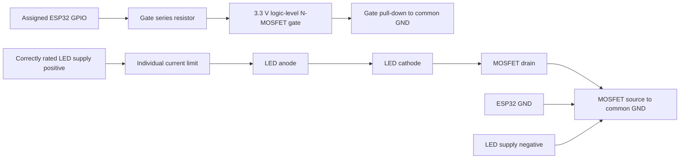

# Wiring aligned with the supplied SmartDryingRack_complete.ino

**The earlier PCA9685/I²C plan is withdrawn for this firmware.** The supplied sketch already assigns GPIO21 and GPIO22 to house lights. Connecting an I²C controller on those pins while running this sketch would conflict. Preserve the assignments below and do not mix the two designs.

This document records the uploaded code's signal assignments. It is **not yet a final circuit verified against the actual expansion board or LED parts**. The board model/terminal pinout, ordinary LED rated voltage/current and fitted resistors, RGB part/pinout and supply ratings are still needed. Do not infer pin identity or polarity from wire color.

## Signal wiring

| Expansion board signal (verify terminal marking) | ESP32 GPIO | Connection |
| --- | --- | --- |
| Rain AO | 34 | Existing AO circuit; ADC input must remain within ESP32 limits |
| Optional rain DO | 27 | Reserved; enabled only by firmware option |
| DHT22 DATA | 4 | Preserve existing sensor wiring/pull-up |
| Servo signal | 18 | Preserve existing suitable external power arrangement |
| Passive buzzer control | 19 | Preserve existing drive circuit |
| Front driver input | 23 | Active-high, 1 kHz PWM |
| Left-side driver input | 22 | Active-high, 1 kHz PWM |
| Right-side driver input | 21 | Active-high, 1 kHz PWM |
| Back driver input | 17 | Active-high, 1 kHz PWM |
| CR driver input | 16 | Active-high, 1 kHz PWM |
| Balcony driver input | 25 | Active-high, 1 kHz PWM |

Code labels such as D23 refer to ESP32 **GPIO23**, not a guaranteed connector position. Confirm the expansion-board schematic/markings and common ground before connecting signals. GPIO16/17 availability assumes WROOM-32, not a PSRAM module variant.

For six appropriately rated, confirmed single-color LED loads, repeat this candidate active-high low-side driver branch for each row above:

This branch is a provisional electrical topology, not a selected circuit for unknown modules. A suitable 3.3 V logic-level MOSFET/load driver prevents the ESP32 from supplying the LED load current. Select voltage/current/thermal ratings from the actual loads. Do not connect a 5 V LED load or an unresisted bare LED directly to GPIO. High-power LEDs may require constant-current drivers and heat sinking rather than a resistor branch.

Each bare LED needs its own current limiting: `R >= (supply_max - LED_Vf_min - driver_drop_min) / target_current`, with tolerance and resistor power margin. Confirm whether each module already has a resistor before selecting values. Final resistor values, gate components, driver parts, supply voltage/current and protection remain unassigned until the electrical details are supplied. Maintain common signal ground; do not run servo or LED load current through GPIO or an undersized ESP32 regulator. Turn power off before changing connections.

Firmware drives house outputs low/OFF at startup and retains 100% selected brightness in RAM. Gate pull-downs or an appropriate driver enable/default-OFF arrangement are needed so loads stay OFF during reset, before firmware configures pins. Validate ESP32-only reset and brownout behavior on the real circuit.

## RGB is disabled until identified

The uploaded optional implementation is specifically for a plain four-pin RGB LED with per-channel current limiting. Reserved signals are R GPIO26, G GPIO32, B GPIO33. It uses digital ON/OFF color channels, not PWM dimming. `STATUS_RGB_ENABLED=false` must remain unchanged until the part/pinout and circuit are confirmed.

Common-cathode, common-anode, addressable WS2812-style and two-wire cycling LEDs are not interchangeable. The optional common-anode direct-signal code is limited to a 3.3 V common connection, never 5 V at a GPIO. Higher voltage/current parts need suitable separate drivers and potentially different polarity. Do not wire or enable these outputs based on colors alone. The app shows the physical indicator as not reported while hardware output is disabled, even though the firmware exposes its logical desired status for diagnostics.

## Required parts and remaining inputs

The final bill of materials needs six ordinary LED ratings, confirmation of fitted resistors, six suitable driver channels/current limits, rated supply rails, reset bias/protection/decoupling and the actual expansion-board connector map. RGB adds a type-specific driver/current-limit design after identification. The existing rack's original power and wiring should be verified to work before adding lighting branches.

If the app and phone browser both cannot reach `/api/status`, first use the firmware's Serial `Device URL` or router DHCP list to find the current IP. A TCP timeout does not identify a particular wiring fault. See [connection troubleshooting](CONNECTION_TROUBLESHOOTING.md) and the [firmware guide](ESP32_FIRMWARE.md).
